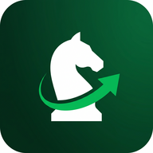

# OpenCheps


Android background chess assistant. Watches your screen with **MediaProjection**, auto-detects the chess board, asks the official **Stockfish 18** engine (NNUE) for the best moves, and draws **multi-PV arrows** over whatever app you're in — controlled by a draggable floating panel.

<p align="center">
  
</p>

## What it actually does

1. **Locate** the chess board on-screen by finding the largest region with strong 8-period checker structure.
2. **Bootstrap** when you open the starting position: it snapshots all 32 piece templates *from the user's own theme* (no shipped model needed) and auto-detects whether the user plays **White or Black** by looking at where the kings/queens end up.
3. **Classify** every later frame by nearest-template-match per square — robust to any board theme because the templates came from this very board.
4. **Side-to-move tracking** via material-delta heuristic (if material decreased → a White piece was just captured → it's now White's turn, etc.) with a sensible fallback that simply toggles sides on each unchanged-board frame.
5. **Stockfish 18** runs as a subprocess of the app, fed UCI commands; replies parsed for `multipv` lines.
6. **Overlay**: the top 3 candidate moves are drawn as colored arrows directly on the screen, with eval labels; a floating draggable panel shows live status, pause/resume, and stop.

## Architecture

```
MainActivity ──▶ MediaProjection intent
       │
       ▼
ScreenCaptureService (FG, type=mediaProjection)
   │  ├── VirtualDisplay + ImageReader  (downscaled frames)
   │  ├── BoardDetector.locate          (find 8x8 grid bbox)
   │  ├── PieceClassifier.tryBootstrap  (auto-train from start position)
   │  ├── PieceClassifier.classifyBoard (nearest-template per square)
   │  ├── FenBuilder.build              (grid → FEN)
   │  └── StockfishEngine.topMoves      (UCI multipv)
                                                       │
                                                       ▼
                                           OverlayService
                                           ├── ArrowOverlayView   (board frame + arrows + eval labels)
                                           └── FloatingPanel      (draggable status/pause/stop)
```

## Stockfish 18

Bundled as `app/src/main/jniLibs/<abi>/libstockfish.so`. CI downloads the **official Stockfish 18** Android tarballs from `official-stockfish/Stockfish/releases/sf_18` and SHA256-verifies:

| ABI | Source | SHA256 |
|---|---|---|
| `arm64-v8a`  | `stockfish-android-armv8` | `cc3b3b74466b6d85cdc0f8cfdad4111c6a44bd0698f4eab96fea7b359a54d3d4` |
| `armeabi-v7a`| `stockfish-android-armv7-neon` | `672fbd7533d15fc70dae82df52c1185236975d059a585aa65eda960f1a3266ea` |

Both binaries are statically linked PIE ELFs built with NDK r27c (~114 MB each, NNUE embedded). Android extracts files matching `lib/<abi>/lib*.so` into the app's `nativeLibraryDir` with execute permissions, so we can `Runtime.exec()` Stockfish directly.

Build settings (set inside `StockfishEngine`):
```
setoption name Threads value 2
setoption name Hash value 48
setoption name MultiPV value 3
setoption name Move Overhead value 100
```

## CI

`.github/workflows/android.yml` builds **per-ABI debug APKs** (~115 MB each) and uploads them as workflow artifacts on every push.

## Build locally

1. Install Android Studio Koala (or newer) with SDK 34.
2. Run the CI workflow once and download the APK, **or** manually drop `libstockfish.so` (arm64-v8a or armeabi-v7a Stockfish 18 from the GitHub release) at `app/src/main/jniLibs/<abi>/libstockfish.so`.
3. `./gradlew :app:assembleDebug` — APKs land in `app/build/outputs/apk/debug/`.

## License

MIT. Stockfish 18 binaries are GPL-3.0 (their license travels with the included binary).
